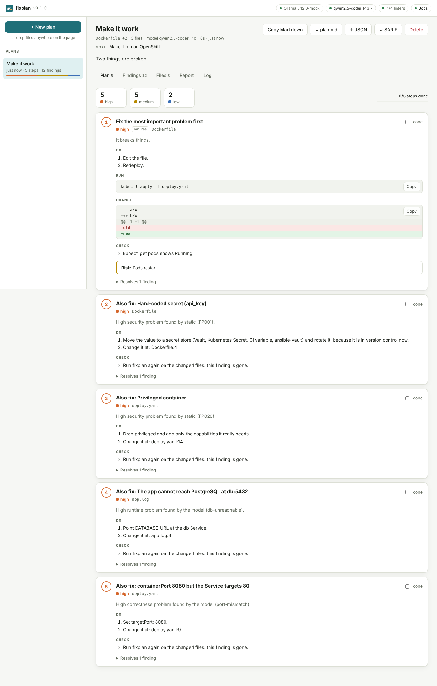

# fixplan

[](https://github.com/jwklijnsma/fixplan/actions/workflows/docker.yml)
[](https://jwklijnsma.github.io/fixplan/)

**Upload anything — code, config, manifests, pipelines, logs, a stack trace — and get back a
step-by-step plan to fix it.** Everything runs on your own hardware with a local Ollama model.

The sibling of [ansreview](https://github.com/jwklijnsma/ansreview) (Ansible) and
[helmreview](https://github.com/jwklijnsma/helmreview) (Helm), but for everything else.

1. **Detect** what each file is: Dockerfile, Kubernetes/OpenShift, Helm, Ansible, Terraform,
   Compose, GitHub Actions, GitLab CI, shell, Python, Go, JS, nginx, systemd, sshd, logs, … (`fixplan types`)
2. **Built-in checks (FP0xx)**: hard-coded secrets, committed keys, `curl | sh`, `chmod 777`,
   TLS verification off, privileged pods, unpinned images, root containers, and known failure
   signatures in logs (OOM, disk full, x509, DNS, CrashLoopBackOff, …).
3. **Linters when installed**: shellcheck, hadolint, ruff, yamllint (all in the container image).
4. **Model review**: every file (big files in chunks) goes past the model, which is told what
   was already found and looks for the rest — and for logs, the root cause.
5. **The plan**: ordered steps — *why*, *what to do*, *commands*, a *patch*, *how to verify*,
   *risk* — grouped so one change fixes related findings. Leaked secrets come first, then what
   breaks, then hardening.

No content leaves your network. Output: Markdown, JSON and SARIF. Without Ollama it still
works (rules + linters, plan ordered by severity).

## Quick start

```bash
git clone https://github.com/jwklijnsma/fixplan.git && cd fixplan
pip install ".[lint]"           # Python 3.10+; shellcheck comes from your distro
ollama pull qwen2.5-coder:14b   # any coding model; bigger is better if VRAM allows
fixplan doctor                  # checks Ollama, the model, its speed and the linters

fixplan ./my-service --host http://gpu-box:11434        # plan in .fixplan/plan.md
fixplan repo.zip -g "make it run on OpenShift"           # with a goal
kubectl logs deploy/api --previous | fixplan - --name api.log   # a log from stdin
fixplan serve --open                                     # web UI on http://localhost:8766
```

## Commands

| Command | |
|---|---|
| `fixplan [plan] <files, folders, .zip/.tar.gz, ->` | Make a fix plan (default command) |
| `fixplan serve` | Web UI: drop files, a folder or an archive, or paste text |
| `fixplan doctor` | Check Ollama, the model and its speed, and the linters |
| `fixplan rules` | List the built-in FP rules |
| `fixplan types` | List the file types it recognises |
| `fixplan init` | Write a sample `~/.fixplan.yml` |

Useful flags for `plan`: `-g/--goal`, `--lang nl`, `--no-llm`, `-f md,json,sarif`,
`-o <dir>`, `--fail-on high|never`, `--max-steps 8`, `--model`, `--host`, `--workers`.

Exit code `1` when a finding is at or above `--fail-on` (default `high`), `2` on a tool
error, `0` otherwise — so it can gate a pipeline.

## Web UI

```bash
fixplan serve        # prints http://localhost:8766/?token=<token>
```

The same React UI as ansreview and helmreview: drop files, a folder or an archive anywhere
on the page, or paste a log; add a goal; get the plan with copyable commands and patches.
Tick steps off as you go, browse findings with the code around them, switch the model from
the top bar, follow jobs in the jobs panel, and download Markdown, JSON or SARIF.



Security as in the siblings: an access token is always required (a cookie after the first
`/?token=` link), POSTs need a CSRF header, the page has a strict CSP. Archives are unpacked
in memory with path-traversal, link, size and file-count checks; uploads are never executed
and are passed to the model as data. An upload can't change any configuration.

## Container

```bash
docker run -d --name fixplan -p 127.0.0.1:8766:8766 \
  --add-host=host.docker.internal:host-gateway \
  -e FIXPLAN_WEB_TOKEN="$(openssl rand -hex 24)" \
  -v fixplan-data:/home/fixplan/.cache/fixplan \
  ghcr.io/jwklijnsma/fixplan
```

As a service: [`deploy/systemd/fixplan.container`](deploy/systemd/fixplan.container)
(Podman Quadlet, rootless, read-only).

## Configuration

`~/.fixplan.yml` (`fixplan init`), every key also as `FIXPLAN_<KEY>`, flags win. The useful
ones: `model`, `ollama_host`, `language` (en/nl), `workers`, `num_ctx`, `goal`,
`house_rules` (e.g. *"We run OpenShift: random UIDs, images from our Quay mirror"*),
`disabled_rules`, `max_steps`, `min_confidence`, `max_upload_mb`.

📖 Full docs: <https://jwklijnsma.github.io/fixplan/>

## Development

```bash
make install && make test     # Python
make web-test && make web     # the React UI in web/, built into src/fixplan/static/
```

Tests use a mock Ollama server (`tests/mock_ollama.py`), so they need no GPU.
`make ui-test` drives the web UI in Chromium (Playwright); `make docs` previews the
[MkDocs Material](https://squidfunk.github.io/mkdocs-material/) site from `docs/`.

| Workflow | |
|---|---|
| `docker` | tests, then the image: built, smoke-tested (CLI + web UI), pushed to GHCR |
| `web` | UI typecheck + tests, built bundle matches the source, then the UI in a real browser |
| `docs` | MkDocs site to GitHub Pages |
| `release` / `auto-release` | version bump, tag, wheel, GitHub release, image; after each merged PR |
| `renovate` / `automerge` | dependency updates, merged on their own when green (patch/minor) |
