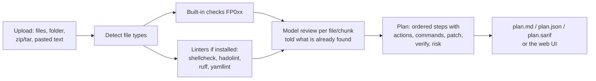

# fixplan

**Upload anything — code, config, manifests, pipelines, logs, a stack trace — and get back a
step-by-step plan to fix it.** Runs on your own hardware with a local Ollama model; no
content leaves your network.

It is the generic sibling of [ansreview](https://jwklijnsma.github.io/ansreview/) (Ansible)
and [helmreview](https://github.com/jwklijnsma/helmreview) (Helm). When an upload contains
Ansible or a Helm chart, fixplan says so and points you to the specialised tool.

## How a plan is made

1. **Intake** — directories, single files, ZIP/tar archives (unpacked in memory with strict
   checks) or text from stdin/the paste box. Binary, vendored and generated files are skipped.
2. **Detection** — about 30 kinds, see [Rules and file types](rules.md#file-types).
3. **Built-in checks** — fast, offline regex and structure checks. See [Rules](rules.md).
4. **Linters** — whichever are installed. All four are in the container image.
5. **Model review** — small files are batched per kind, big files are cut into line-numbered
   chunks. Findings for files that were not in the request, or below `min_confidence`, are
   dropped.
6. **The plan** — one model request that sees the goal, all findings and (as far as the
   context allows) the most affected files. The answer is validated: unknown files and
   finding ids are removed, and any high or critical finding the model left out gets a step
   of its own. If the model fails, the plan is built from the rules instead.

## Next

- [Install](install.md) and [use it from the command line](usage.md)
- [The web UI](web-ui.md)
- [Run it as a container or service](deploy.md)
