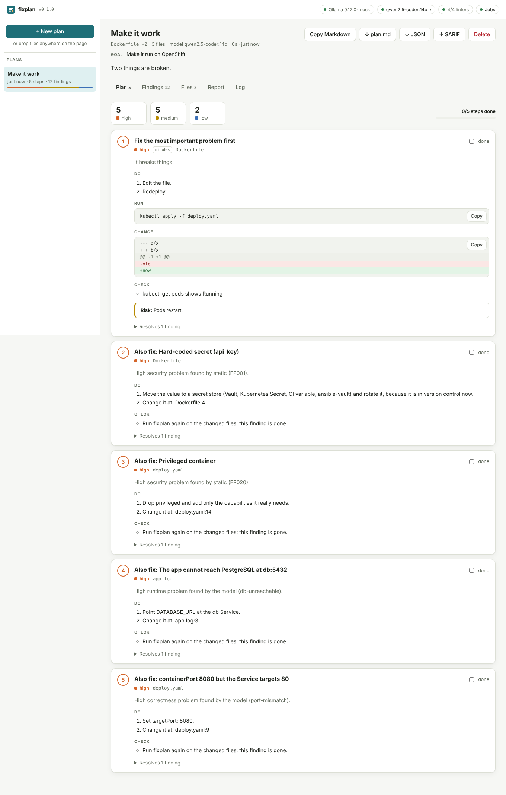
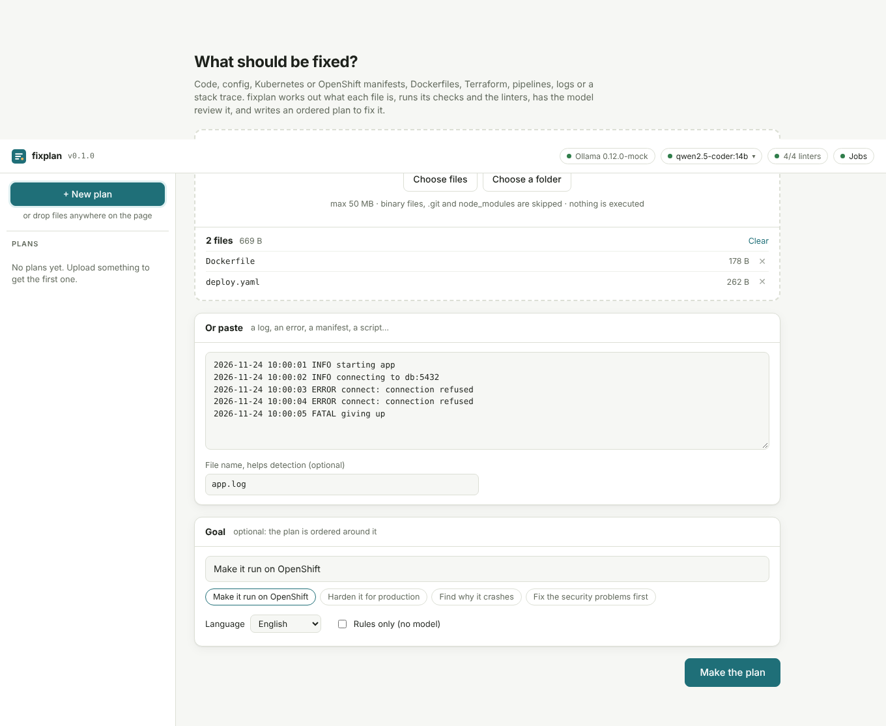
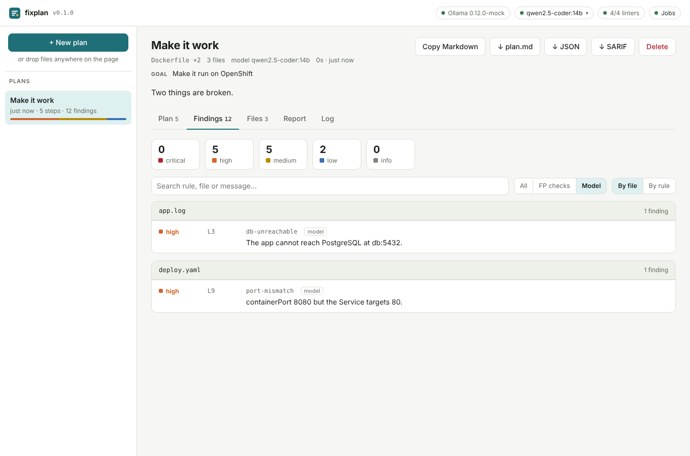

# Web UI

```bash
fixplan serve                 # prints http://localhost:8766/?token=<token>
FIXPLAN_WEB_TOKEN=$(openssl rand -hex 24) fixplan serve --bind 0.0.0.0
```

Built like the ansreview and helmreview UIs, and it works the same way: a React app,
built into the Python package, so no Node is needed to run it and nothing comes from a CDN.



## Make a plan

- **Upload**: drop files, a whole folder or a ZIP/tar archive anywhere on the page, or use
  *Choose files* / *Choose a folder*. `.git`, `node_modules`, virtualenvs and build output are
  left out in the browser already.
- **Paste**: a log, an error, a manifest. Give it a file name (`app.log`, `Dockerfile`) if
  detection would get it wrong.
- **Goal**: optional; the plan is ordered around it. The chips fill in common ones.
- **Language** (English/Nederlands) and **rules only** (no model, a plan in seconds).
  When Ollama is unreachable, rules only is switched on for you.



## Read the plan

| Tab | |
|---|---|
| **Plan** | the steps: why, what to do, commands and patches (with copy buttons), how to check, risk, and which findings each step resolves. Tick a step *done*; this browser remembers it. |
| **Findings** | every finding, by file or by rule, filtered by severity, source (FP checks, linters, model) and text. Open one for the suggested fix and the code around it. |
| **Files** | what was uploaded and what each file was detected as; click to read it. |
| **Report** | `plan.md` rendered, to copy into an issue or merge request. |
| **Log** | what the job did, including skipped files and missing linters. |

Downloads: `plan.md`, JSON and SARIF. **Copy Markdown** puts the whole plan on the clipboard.



## Top bar

Ollama status, the **model picker** (every installed model; the choice applies to new plans
until the server restarts), how many linters are installed, and **Jobs**: plans are made one
at a time (one GPU) and keep running when you close the page. Cancel or remove them there.

Finished plans are kept in `~/.cache/fixplan/jobs` (`--data` to change it), the newest 100,
with the uploaded text so the code snippets keep working after a restart.

## Security

| | |
|---|---|
| Token | Always on. Set `FIXPLAN_WEB_TOKEN` to keep one; otherwise a new random token is made on every start. Open the printed `/?token=` link once: the token becomes an HttpOnly, SameSite=Strict cookie and leaves the address bar. `--no-token` only on localhost or behind a proxy that authenticates. |
| CSRF | Every POST from a browser needs the `X-Fixplan: 1` header, which another site cannot send. Scripts use `Authorization: Bearer <token>` instead. |
| Page | Strict Content-Security-Policy (no inline script, nothing from other origins), `frame-ancestors 'none'`, `nosniff`, no referrer. |
| Uploads | Size limit `max_upload_mb` (default 50, unpacked). Archive entries with `..`, absolute paths, links or device files are skipped. Nothing is executed; linters read a private temp copy. |
| Model | Uploaded content is passed as data between markers, with an explicit instruction not to follow instructions in it. Uploads cannot change any configuration. |

## API

Send `Authorization: Bearer <token>` (or the cookie plus `X-Fixplan: 1`).

| | |
|---|---|
| `GET /api/status` | version, Ollama, model and installed models, linters |
| `POST /api/settings` | `{"model": "qwen2.5-coder:32b"}`; `""` = back to the default |
| `POST /api/jobs` | `{files: [{name, data (base64)}], text, text_name, goal, language, no_llm}` |
| `GET /api/jobs` | all jobs |
| `GET /api/jobs/<id>?since=N` | status, progress, the plan and new log lines |
| `GET /api/jobs/<id>/file?path=` | an uploaded file's text |
| `GET /api/jobs/<id>/plan.md` (`.json`, `.sarif`) | downloads |
| `POST /api/jobs/<id>/cancel`, `POST /api/jobs/<id>/delete` | |
| `GET /healthz` | liveness, no token |

## Working on the UI

```bash
make web-dev      # Vite with hot reload on :5173, next to `make serve` on :8766
make web-test     # typecheck + vitest
make web          # build into src/fixplan/static/ and commit it
make ui-test      # Playwright: the whole UI in Chromium against a mock Ollama
```

The `web` workflow checks that the committed bundle matches the source (and rebuilds it on
Renovate PRs), then runs the browser test and keeps its screenshots.
